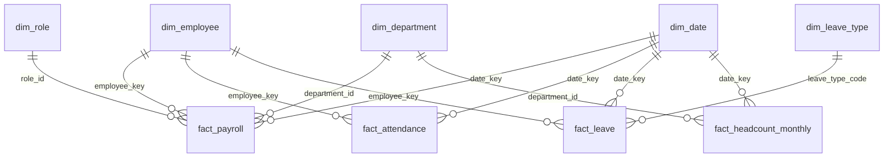

# Warehouse Schema (dw)

## Grain of each fact table

- fact_payroll: one row per employee per payroll run (payroll_item_id).
- fact_attendance: one row per employee per day.
- fact_leave: one row per leave request.
- fact_headcount_monthly: one row per department per month.

## Dimensions

- dim_employee: one row per employee version (employee_key), with valid_from and valid_to. A transfer creates a new version, so each month's payroll joins to the department that was valid for that month.
- dim_department, dim_role, dim_leave_type: one row per department, role, or leave type.
- dim_date: one row per calendar day (date_key).

## Schema diagram

Star schema: fact_payroll, fact_attendance, fact_leave, and fact_headcount_monthly sit in the middle. dim_employee, dim_department, dim_role, dim_leave_type, and dim_date surround them, joined by employee_key, department_id, role_id, leave_type_code, and date_key.

